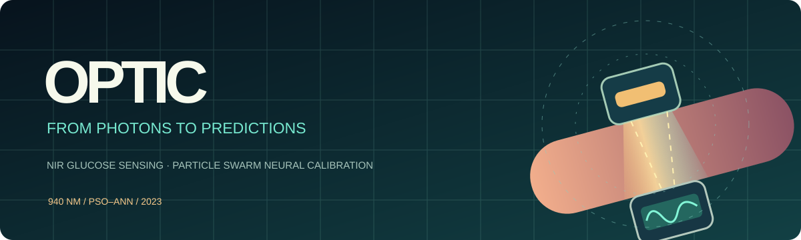
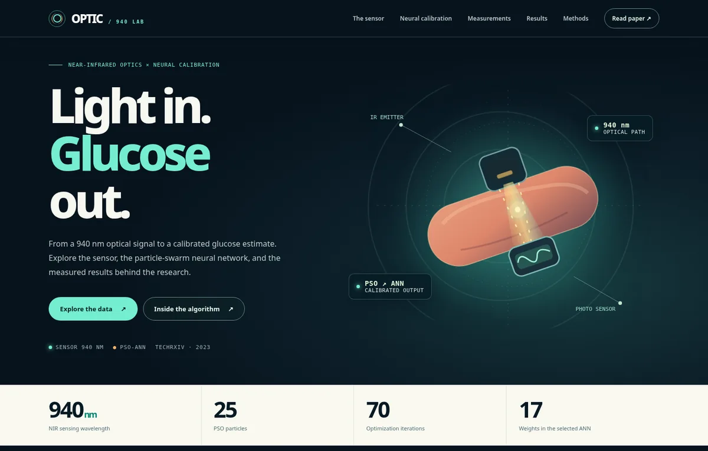

<div align="center">



# OPTIC · Near-Infrared Glucose Monitoring

**940 nm optical sensing · Particle-swarm neural networks · Computational calibration**

Companion software for *Non-Invasive Continuous Glucose Monitoring using Near Infrared Sensors and PSO-ANN Algorithm*.

[**Manuscript**](https://doi.org/10.36227/techrxiv.24465955.v1) · [**Interactive project page**](https://rdharini2001.github.io/CGM_IR/) · [**Deterministic weight recipe**](docs/WEIGHT_RECIPE.md) · [**Training methods**](docs/TRAINING.md) · [**Numerical results**](docs/RESULTS.md) · [**References**](docs/REFERENCES.md)

</div>

---

## Overview

OPTIC implements the near-infrared glucose calibration workflow on the measurements published with the manuscript. It includes **eight PSO–ANN architectures, seven regression families, their saved fitted parameters, and both model-training and forward-inference code**. The accompanying interactive website presents the optical measurement chain, trained network connections, patient measurements, glucose agreement, and numerical comparisons.

The primary ANN inputs are voltage (mV), age (years), and BMI. The selected **3–3–2–1 network has 17 neural weights**, fitted with 25 PSO particles over 70 iterations. Its neural output is extended by a regularized radial-basis-function residual correction. The regression comparisons use related calibration models, some of which also require the non-invasive device's initial glucose estimate.

The release is a **retrospective, published-data calibration case study**. It includes an independently executable **neural-weight replay experiment**: fixed-seed PSO trained on the 30 observations alone reproduces all eight saved neural-weight vectors exactly. A 40-run seed experiment documents parameter variability; the subsequent constrained-calibration stage still uses the published model-summary targets. The network weights, correction coefficients and selected scoring populations are fitted to 30 published observations from ten participants, **with the manuscript's aggregate numerical results used as calibration constraints**. The resulting 51 exact numerical matches are therefore calibration-fit results, not estimates of accuracy on new patients. The website's Clarke-grid extension includes explicitly labeled simulated readings. All artifacts and scientific assumptions can be inspected in the code and [study design](docs/STUDY_DESIGN.md).

## Interactive project page

[](docs/index.html)

Select any ANN architecture to inspect its actual connection weights, explore the observed before/after/random glucose readings, compare the seven regression families, follow the 70-step optimizer trajectories, and export the resulting model table. The new **Training laboratory** also compares five PSO seeds for each architecture and runs a fully interactive, local three-input forward prediction with its neural and residual-correction contributions displayed separately. The page is generated locally from the saved model predictions and numerical tables; no web server or external plotting service is required.

## Installation

Python **3.11 or newer** is recommended. We use scikit-learn-based serialization for the regression calibrators; only load `.joblib` files from a trusted source.

```bash
python -m venv .venv
source .venv/bin/activate
python -m pip install -r requirements.txt
```

For the optional PSO-versus-Adam convergence reconstruction, install PyTorch with `python -m pip install -r requirements-training.txt`. On Windows, activate with `.venv\Scripts\activate`.

## Train the calibration models

Refit **all eight ANN architectures and seven regression calibrators** from the manuscript measurements and numerical calibration constraints, then regenerate the saved weights, predictions, 51 scores, diagnostic figures, and website:

```bash
bash run_all.sh --train
```

The training program `src/train_realization.py` applies the paper's 25-particle, 70-iteration PSO to each network, fits its regularized RBF calibration, determines the explicitly defined calibration scoring populations, and serializes the fitted parameters under `models/`. The regression framework fits seven baseline estimators and their discrepancy corrections. Seeds and model configurations are specified in the source. A separate forward pass recomputes all 51 scores **from the fitted model artifacts** and checks them against the printed numerical table.

To audit the neural-weight training recipe separately from aggregate calibration, run:

```bash
bash run_all.sh --recipe
```

This independently refits the neural networks from the 30 measurement pairs, compares each of their neural weights with the included saved artifacts, checks four alternative seeds per architecture, and writes parameter traces and a seed-sensitivity figure. It does **not** use manuscript table targets to train the neural weights. The calibration fitting stage described above **does** use the manuscript numerical targets; see the [complete weight recipe](docs/WEIGHT_RECIPE.md). The website's training laboratory also runs the saved network and Gaussian correction locally from your chosen inputs.

To also regenerate the supplementary 28.7% PSO/Adam convergence-slope scenario (requires PyTorch):

```bash
bash run_all.sh --train-all
```

The slope scenario uses an Adam learning rate inferred using the published slope difference; the Clarke-grid scenario includes nine simulated, explicitly flagged readings. See [Training and parameter estimation](docs/TRAINING.md) and [Supplementary numerical definitions](docs/TECHNICAL_APPENDIX.md).

## Forward inference and verification

**Using the bundled fitted models requires no retraining.** To make a single three-input PSO–ANN prediction:

```bash
python predict.py --model 3-3-2-1 --voltage 380 --age 51 --bmi 22.2
```

For a regression calibrator, supply the device's already-calibrated reading as a fourth feature:

```bash
python predict.py --model pso_ann --voltage 380 --age 51 --bmi 22.2 --device-glucose 89.2
```

List models with `python predict.py --list-models`. Predictions are in mg/dL and are **for computational research only**, not for diagnosing or managing glucose levels.

To regenerate all model predictions and the website **without changing the fitted parameters**, run:

```bash
bash run_all.sh
# equivalent:
bash run_all.sh --verify
```

The forward-only scorer intentionally does not read the paper's numerical targets; its weights and evaluation populations were established during the preceding, target-conditioned fitting stage.

## Repository layout

| Path | Contents |
|---|---|
| `data/` | Manuscript measurements and published numerical constraints |
| `src/pso.py` | Reproducible particle swarm optimizer for ANN weights |
| `src/weight_recipe.py` | Replay all saved neural weights and sweep alternate swarm seeds |
| `src/trace_forward.py` | Explain individual ANN activations and Gaussian correction terms |
| `src/train_realization.py` | Train architectures, regression baselines and fitted calibration models |
| `src/runtime.py` | Standalone forward predictor for trained parameters |
| `src/verify_forward.py` | Regenerate 450 predictions and the 51 calibration-score endpoints |
| `src/audit_targets.py` | Verify numerical precision against manuscript tables |
| `src/heldout_control.py` | Participant-held-out sensitivity assessment |
| `docs/WEIGHT_RECIPE.md` | Exact seed schedule, neural weight replay, inverse calibration distinction |
| `src/optimizer_slopes.py` | Optional PSO/Adam convergence experiment |
| `models/` | Eight trained ANN archives and seven serialized regression calibrators |
| `results/`, `figures/` | Score tables, parameter summaries, predictions and plots |
| `docs/` | Interactive GitHub Pages site and methodological documentation |
| `scripts/build_site.py` | Generate the website from saved model outputs |
| `tests/` | Artifact, numerical, training and website consistency checks |

## Source measurements and interpretation

Ten participants (S1–S10) contribute three voltage/reference glucose pairs each, recorded before loading, after loading, and at a random time. A separate table documents ten additional participants with glucose/HbA1c comparisons. The published numerical tables do not include continuous NIR waveforms. Model-specific weighted populations reflect fitted statistical weights, **not additional patients**.

The training process uses reported summary values as numerical constraints; the close agreement of fitted scores with those constraints is an expected property of that calculation. Participant-disjoint control evaluations are provided separately and must not be equated with the calibration-fit scores. For a formal description of these distinctions, see [Methods](docs/METHODS.md) and [Study design](docs/STUDY_DESIGN.md).

## Publication and citation

**Manuscript:** [Non-Invasive Continuous Glucose Monitoring using Near Infrared Sensors and PSO-ANN Algorithm](https://doi.org/10.36227/techrxiv.24465955.v1), TechRxiv (2023).

```bibtex
@misc{raghavan2023nirglucose,
  title = {Non-Invasive Continuous Glucose Monitoring using Near Infrared Sensors and PSO-ANN Algorithm},
  author = {Raghavan, Dharini and Suma, K. V. and Karki, Maya V. and Sharma, Narayana and Rao, Gundu H. R.},
  year = {2023},
  publisher = {TechRxiv},
  doi = {10.36227/techrxiv.24465955.v1},
  url = {https://doi.org/10.36227/techrxiv.24465955.v1}
}
```

See [`CITATION.cff`](CITATION.cff), [`REFERENCES.bib`](REFERENCES.bib), and [methodological references](docs/REFERENCES.md). Software is distributed under the [MIT license](LICENSE). Source numerical data are reproduced from the cited paper; consult its terms for reuse.

## GitHub Pages

Enable **Settings → Pages → Deploy from a branch → `main` / `docs`**. The existing website works as a static page; refresh it after training with `python scripts/build_site.py`.
