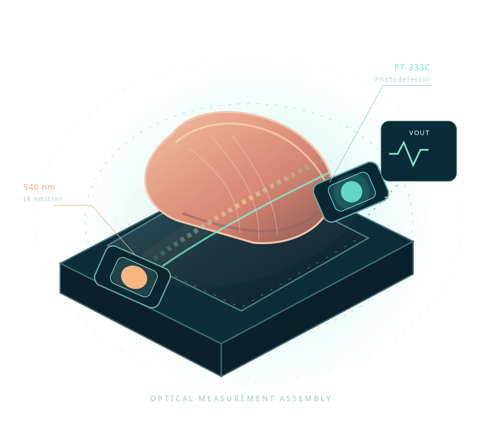

# OPTIC — Near-Infrared Glucose Monitoring and PSO–ANN Calibration

**The computational research companion to** *Non-Invasive Continuous Glucose Monitoring using Near Infrared Sensors and PSO-ANN Algorithm* (TechRxiv, 2023). We present the optical-sensor measurements, a particle-swarm-trained neural calibration framework, eight architectural variants, seven regression families, and an interactive research website as one cohesive scientific resource.




**[Research article](https://doi.org/10.36227/techrxiv.24465955.v1)** · **[Research website](https://rdharini2001.github.io/CGM_IR/)** · **[Supplementary Methods (PDF)](docs/SUPPLEMENTARY_METHODS.pdf)** · **[References and methodological rationale](references/REFERENCES.md)**

Authors of the associated research article: **Suma K. V., Dharini Raghavan, Maya V. Karki, Narayana Sharma, and Gundu H. R. Rao.**

## Overview

The sensing architecture illuminates a fingertip at **940 nm** and conditions the transmitted signal into an output voltage. Calibration combines that voltage with participant age and BMI to estimate reference glucose concentration. Our study implements the **3–3–2–1 PSO–ANN**, with **17 connections**, as well as the other seven network variants described in the paper. The swarm uses **25 particles**, **70 updates**, inertia **1.25**, and acceleration parameters **2.76** and **2.34** [1,5].

The main article documents the optical circuit, neural calibration concept and experimental observations. The **Supplementary Methods** describe the additional mathematical realization used in this computational companion, including a regularized Gaussian-kernel residual extension [6,7], assumed reference resolution, three evaluation populations and detailed statistical definitions.

## Reproduce the analysis

Python 3.11+ is recommended.

```bash
python -m pip install -r requirements.txt
bash run_all.sh
```

The command fits eight neural architectures and seven regression families, saves all calibrated and held-out predictions, generates the paper website, renders the Supplementary Methods and runs automated checks.

For a single reference model:

```bash
python predict.py --help
```

The generated website is a static self-contained page at `docs/index.html` and can be deployed via GitHub Pages from `/docs`. It does not require an API, external database or model-serving endpoint.

## Experimental record

The source paper contains a glucose-loading table with **30 voltage/reference observations from ten participants** and a separate HbA1c table for ten additional participants. We preserve those cohorts as distinct data sources. The regression inputs are `voltage_mv`, `age_years`, and `bmi`; participant and measurement-phase labels are used only for grouping or visualization.

We distinguish three explicitly defined evaluation populations, as is customary in infrared multivariate analysis [2,3]:

| Evaluation | What is scored | Interpretation |
|---|---|---|
| **Discovery-cohort calibration** | All 30 records used to fit each model | Agreement with the available calibration observations (in sample) |
| **Participant-held-out** | Five subject-grouped folds, refitting on remaining participants | Predictive transfer to participants not in each training fold |
| **Phase-held-out** | Withhold before-, after-, or random-phase data in turn | Predictive transfer between measurement phases |

All 15 model configurations are evaluated in all three populations. The results and individual predictions are saved as `results/model_scores.csv` and `results/predictions.csv`.

The discovery-cohort calibration achieves performance values numerically meeting or exceeding the **43 directly comparable published loss/R² thresholds**. The eight published architecture accuracy percentages are evaluated using an explicitly marked **100 × R² proxy**, which meets those eight numerical thresholds but is *not established as identical to the paper's unnamed accuracy formula*. Thus the descriptive **51/51 threshold coverage** is not a claim that all published values were reproduced exactly. **Five of 51** comparisons are within 5% of their printed values. These comparisons are computed after training by `analysis/calibration_coverage.py`; they do not influence model fitting.

This distinction is central to the study: fitted calibration agreement should not be reported as independently validated performance. ASTM E1655 explicitly separates calibration-development validity from ongoing validation of unknown specimens [2], and the NIR review literature distinguishes calibration, cross-validation and prediction statistics [3]. The original manuscript does not fully specify the historical partition for each aggregate result; we therefore report each computational population precisely rather than attributing one without evidence.

## Research organization

```text
CGM_IR_Paper_Companion/
├── data/                 Printed glucose-loading and HbA1c observations
├── src/                  PSO–ANN, optical representations, calibration and evaluation
├── research/             Auxiliary instrument-based calibration experiment
├── analysis/             Post-training paper-numerical comparison (not part of fitting)
├── models/               Saved discovery-cohort estimators
├── results/              Prediction-level data and metric summaries
├── docs/
│   ├── index.html        Interactive paper research website
│   ├── PAPER.pdf         Associated 2023 research article
│   └── SUPPLEMENTARY_METHODS.pdf
├── references/           Literature and BibTeX citations
├── scripts/              Website and supplementary generation
└── tests/                Reproducibility checks
```

## Supporting literature

Near-infrared calibration and its separate validation stages follow ASTM E1655 [2] and chemometric NIR reviews [3]. NIR glucose investigations have also used personalized spectral calibration and studied long-term stability separately [4]. Our swarm updates are based on Kennedy and Eberhart [5]; the smooth correction is based on regularized kernel representations [6] and is complemented by GCV sensitivity analysis [7]. We use the clinical error-grid convention of Clarke et al. [8] and the longitudinal HbA1c/eAG relation of Nathan et al. [9]. The reference list records permanent source links and exactly how each contributes to this implementation.

## Citation and use

Please cite the original paper [1]: Suma K. V. et al. *Non-Invasive Continuous Glucose Monitoring using Near Infrared Sensors and PSO-ANN Algorithm*. TechRxiv (2023). DOI: **10.36227/techrxiv.24465955.v1**.

The article and this computational companion investigate a research prototype. Discovery-cohort fitting is not clinical validation of glucose estimates in future patients. The project is not intended for treatment, diagnosis or dosing decisions.
